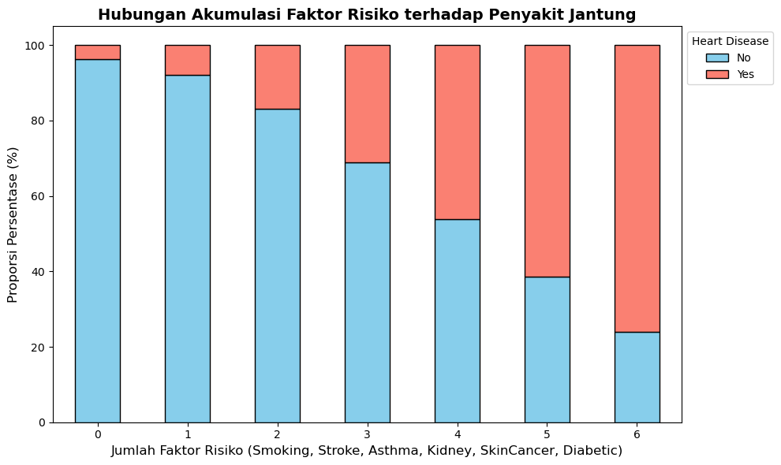
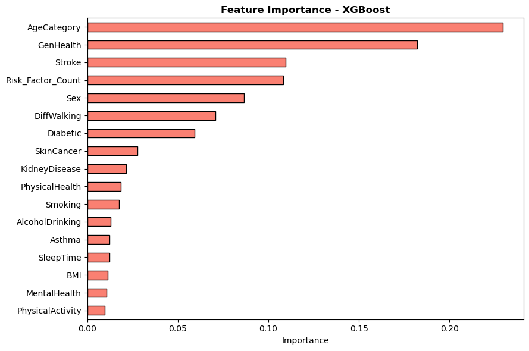
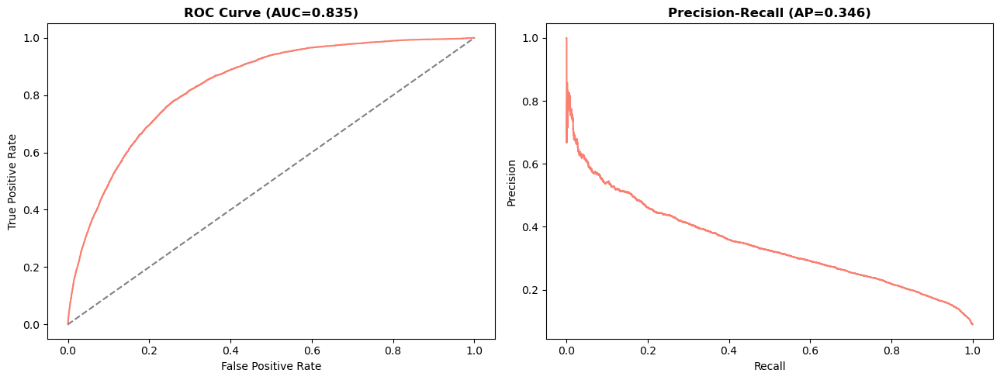
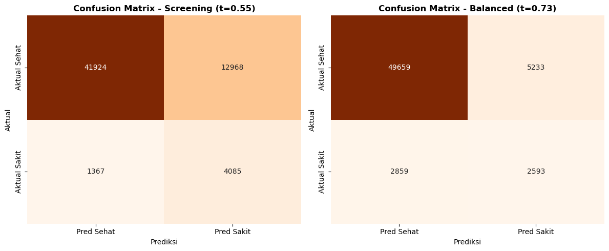

# Heart Disease Prediction

I used the CDC BRFSS 2020 survey data to predict whether a person has heart disease from their health and lifestyle answers. The notebook covers data cleaning, exploratory analysis, feature engineering and an XGBoost model.

## Data

The dataset is "Personal Key Indicators of Heart Disease" on Kaggle:
https://www.kaggle.com/datasets/kamilpytlak/personal-key-indicators-of-heart-disease

It has 319,795 rows and 18 columns. To run the notebook, download `heart_2020_cleaned.csv` and put it in the `data` folder. I did not upload the data to this repo.

## What I did

- Checked duplicates, missing values, inconsistent categories and outliers. There were 18,078 duplicate rows, which I removed, leaving 301,717 rows. There were no missing values.
- Clipped BMI and SleepTime to the IQR bounds. PhysicalHealth and MentalHealth are counts of days (0 to 30), so I kept them as they are.
- Merged the Diabetic categories into yes and no.
- Made two new features: Risk_Factor_Count (smoking, stroke, asthma, kidney disease, skin cancer, diabetes) and BMI_Category.
- Plotted heart disease rate by risk factor, by BMI group and by number of risk factors.
- Split the data into train, validation and test sets (193,098 / 48,275 / 60,344 rows) and fitted the scaler on the training set only.
- Only about 9% of people in the data have heart disease, so I used scale_pos_weight in XGBoost.
- Tried 8 parameter combinations with 3-fold stratified cross-validation and picked the best one by ROC-AUC.
- Chose the classification thresholds on the validation set, then checked them once on the test set.

## Results

Best setup: max_depth 5, learning_rate 0.05, n_estimators 400.

- Cross-validation ROC-AUC: 0.836
- Test ROC-AUC: 0.835
- Test PR-AUC: 0.346

I looked at two thresholds on the test set:

- 0.55 (aimed at recall of at least 0.75): recall 0.749, precision 0.240 for heart disease
- 0.73 (best F1 on validation): recall 0.476, precision 0.331

The first one catches more people with heart disease but gives many false alarms. For screening I would pick it, since missing a sick person is worse than a false alarm.

The most important features were age category, general health, stroke, risk factor count and sex.

## Plots

Heart disease rate goes up as the number of risk factors goes up:



Feature importance from the XGBoost model:



ROC and precision-recall curves on the test set:



Confusion matrices for the two thresholds:



## Notes

The data comes from a self-reported survey, so some answers may not be accurate. The model is not meant for diagnosis.

## Run

```
pip install -r requirements.txt
jupyter notebook heart_disease_analysis.ipynb
```

Tools: Python, pandas, NumPy, scikit-learn, XGBoost, Matplotlib, Seaborn.
